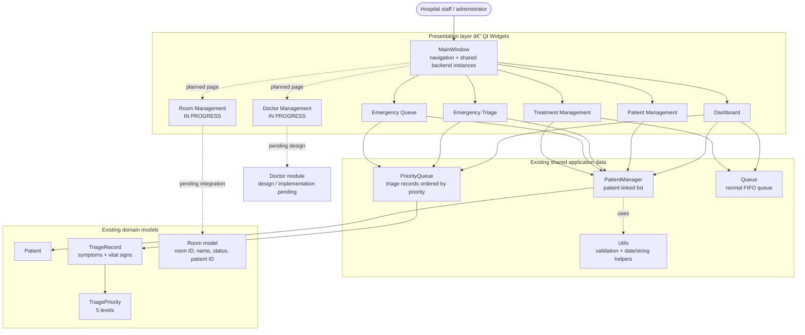

# Hospital Emergency Management System

A desktop Hospital Emergency Management System built with **C++17** and **Qt 6 Widgets**. The current application uses a shared `MainWindow` to coordinate GUI pages and reusable data structures for patient records, emergency triage, and waiting queues.

> **Architecture status:** This README is based on the supplied project source snapshot. Doctor Management and Room Management are included as work-in-progress modules in the architecture. The source currently contains a `Room` model, but no Doctor module or connected Doctor/Room management workflow was found in this snapshot.

## Architecture preview



**Diagram legend**
- Solid lines: relationships visible in the current source.
- Dashed lines: planned or incomplete integration; not yet implemented in the supplied snapshot.

## Module status

| Module | Current status | Source evidence / notes |
|---|---|---|
| Main window and navigation | Implemented | `MainWindow` creates and owns the five existing GUI pages and shared backend instances. |
| Dashboard | Implemented | Reads patient and queue data through shared backend pointers. |
| Patient Management | Implemented | Uses `PatientManager`. |
| Emergency Triage | Implemented | Uses `PatientManager` and `PriorityQueue`. |
| Emergency Queue | Implemented | Uses `PatientManager` and `PriorityQueue`. |
| Treatment Management | Implemented | Uses `PatientManager` and the normal FIFO `Queue`. |
| Doctor Management | In progress / not present in this snapshot | No Doctor model, manager, GUI page, or Doctor source files were found. |
| Room Management | In progress / partial model exists | `src/model/room.h` defines a `Room` struct, but no Room manager, GUI page, or application integration was found. |
| Database integration | Planned / not connected | The current Qt application initializes sample records in memory. |

## Existing application modules

| Layer | Main files / classes | Responsibility |
|---|---|---|
| Application entry | `src/main.cpp` | Starts `QApplication` and opens `MainWindow`. |
| Main window | `src/gui/include/mainwindow.h`, `src/gui/data/mainwindow.cpp` | Owns shared backend instances, creates the five current pages, handles navigation, seeds sample data, and coordinates page refreshes. |
| Dashboard | `src/gui/include/dashboard.h`, `src/gui/data/dashboard.cpp` | Displays patient totals, queue statistics, triage distribution, and queue preview. |
| Patient GUI | `src/gui/include/patient.h`, `src/gui/data/patient.cpp` | Patient record interface. |
| Triage GUI | `src/gui/include/triage.h`, `src/gui/data/triage.cpp` | Emergency triage interface. |
| Emergency queue GUI | `src/gui/include/emergency.h`, `src/gui/data/emergency.cpp` | Emergency queue interface and priority counts. |
| Treatment GUI | `src/gui/include/treatment.h`, `src/gui/data/treatment.cpp` | Normal waiting queue and treatment page. |
| Patient data | `src/include/PatientManager.h`, `src/data/PatientManager.cpp` | Linked-list-based patient record management and ID assignment. |
| Emergency priority queue | `src/include/PriorityQueue.h`, `src/data/PriorityQueue.cpp` | Priority queue of triage records. |
| Normal queue | `src/include/Queue.h` | FIFO linked queue of patient IDs. |
| Patient model | `src/model/Patient.h` | Patient information structure. |
| Triage model | `src/model/triage.h` | Triage record and priority definitions. |
| Room model | `src/model/room.h` | Existing `Room` data structure; not yet connected to a manager or GUI. |
| Utilities | `src/include/utils.h`, `src/data/utils.cpp` | Shared validation, date/time, and string helper functions. |

## Doctor Management — integration point

Doctor Management is represented as a planned module in the diagram, not as a completed implementation. The supplied source snapshot does not define its model, manager, GUI, fields, or workflow.

When the Doctor module is ready, add its confirmed files and responsibilities here, then connect it to the relevant application workflows. No Doctor attributes or assignment rules are assumed in this preview.

## Room Management — integration point

The project already contains `src/model/room.h` with this structure:

```cpp
typedef struct {
    int roomID;
    std::string roomName;
    std::string status;
    int patientID;
} Room;
```

The model is not currently listed in `hospital.pro`, and the current `MainWindow` does not create a Room manager or Room GUI page. Room Management is therefore shown as in progress, with the model available as a starting point. Room allocation, availability rules, and patient-room assignment workflows are intentionally not assumed.

## Core data flow currently implemented

1. `MainWindow` creates one shared `PatientManager`, one `PriorityQueue`, and one normal FIFO `Queue`.
2. The current GUI pages receive pointers to these shared instances and operate on the same in-memory records.
3. `PatientManager` stores patient details. `PriorityQueue` stores triage records associated with patient IDs.
4. The emergency triage model uses five priority levels:

   | Value | Priority |
   |---:|---|
   | 1 | Resuscitation |
   | 2 | Emergent |
   | 3 | Urgent |
   | 4 | Less Urgent |
   | 5 | Non-Urgent |

5. `MainWindow` connects page signals to refresh related pages after data changes.

## Repository structure

```text
project-hospital/
├── config/
│   └── hospital.pro
├── resources/
│   ├── images/
│   ├── styles/
│   └── resources.qrc
├── src/
│   ├── main.cpp
│   ├── include/          # shared data structures and utilities
│   ├── model/            # Patient, TriageRecord, and Room models
│   ├── data/             # PatientManager and PriorityQueue implementations
│   └── gui/
│       ├── include/      # current Qt page declarations
│       └── data/         # current Qt page implementations
├── debug/
└── release/
```

## Technology stack

- **Language:** C++17
- **GUI:** Qt 6 Widgets
- **Build system:** qmake (`config/hospital.pro`)
- **Data structures:** linked list, priority queue, FIFO queue
- **Styling:** Qt Style Sheets (`.qss`) embedded through Qt resources

## Current implementation checklist

- [x] Qt Widgets main window and five-page navigation
- [x] Shared in-memory patient manager
- [x] Five-level emergency triage priority model
- [x] Emergency priority queue
- [x] Normal FIFO waiting queue
- [x] Dashboard and cross-page refresh coordination
- [x] Initial Room data structure
- [ ] Room manager and Room GUI integration
- [ ] Doctor model, manager, and GUI integration
- [ ] Persistent database integration
- [ ] Production authentication and role management
- [ ] Persistent treatment history

## Build

Run qmake from the directory containing `hospital.pro`, using a compiler toolchain compatible with the installed Qt kit.

```bash
cd config
qmake hospital.pro
make
```

On Windows with the Qt MinGW kit, use the matching `mingw32-make` executable instead of `make`.

---

*This architecture preview documents the supplied source snapshot. Update the module status and diagram as Doctor and Room implementation progresses.*
